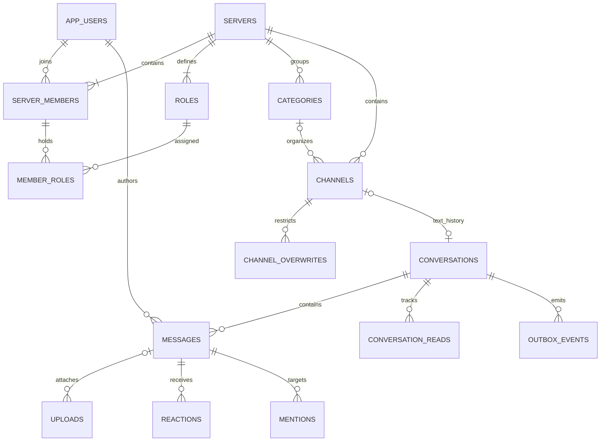

# Database schema

[Reference PostgreSQL DDL](schema.sql) defines the proposed 25-table schema. It is documentation, not a migration and has not been applied to Neon. Existing `posts` and `jobs` remain untouched. Translate the model into Drizzle and generate a reviewed migration before implementation.

## 1. Model and relationships

DM conversations reference two users directly using the sorted UUID pair. No generic participant table is needed for 1:1 scope. Channel conversation access comes from current server/channel permissions, not duplicated membership rows. Voice channels do not have message conversations in v1.

## 2. Data dictionary

All primary IDs are UUID unless a composite key is specified. User references use local `app_users.id`; Clerk identity maps through unique `clerk_id`. Times are UTC `timestamptz`, localized only for display. Sequence numbers and permissions are PostgreSQL bigint and decimal strings on the wire.

| Table                    | Meaning and critical attributes                                                                                  |
| ------------------------ | ---------------------------------------------------------------------------------------------------------------- |
| app_users                | Identity projection, canonical handle, display name, avatar, bio, presence preference, theme, disabled timestamp |
| servers                  | Owner, name/icon, authorization revision, soft deletion                                                          |
| server_members           | Composite server/user membership; nickname and join timestamp                                                    |
| roles                    | Server-scoped permission mask, color, unique role ID, rank and everyone marker                                   |
| member_roles             | Composite membership-role assignment, same-server composite foreign keys                                         |
| categories               | Server grouping and order; no permission inheritance                                                             |
| channels                 | Text/voice kind, category, name/topic, position, soft deletion                                                   |
| channel_overwrites       | Exactly one role or member target with disjoint allow/deny masks                                                 |
| server_bans              | Server/user ban, actor, reason and creation timestamp                                                            |
| invites                  | Hashed bearer token, expiry, usage limit/counter and revocation                                                  |
| friendships              | Canonical sorted pair, initiator and pending/accepted state                                                      |
| blocks                   | Directional blocker/blocked pair; either direction blocks DM sending                                             |
| conversations            | Exactly one channel link or one canonical DM pair; durable sequence counters                                     |
| messages                 | Conversation-local sequence, author, dedupe nonce/hash, reply, body, version, tombstone, search vector           |
| uploads                  | Owner, conversation, staging/final key, validated metadata, lifecycle state and optional message binding         |
| reactions                | Message/user/Unicode emoji unique tuple                                                                          |
| mentions                 | Message/mentioned-user pair, no role or broadcast mentions                                                       |
| conversation_reads       | Per-user high-water message sequence                                                                             |
| conversation_preferences | Per-conversation alert mode and temporary mute deadline                                                          |
| voice_sessions           | User/channel, provider session, mute/deaf flags and expiring participation lease                                 |
| outbox_events            | Ordered conversation change log and other audience invalidations; retry/lease/dead-letter fields                 |
| audit_events             | Moderation and configuration actions; minimal metadata, no message bodies                                        |
| mutation_keys            | Per-actor operation/request deduplication and result reference                                                   |
| webhook_receipts         | Verified provider event deduplication                                                                            |
| asset_uploads            | Separate staged/validated avatar and server-icon uploads, with purpose and ownership                             |

## 3. Database versus service enforcement

DDL enforces foreign keys, same-server role/member/category targets, same-conversation reply and attachment references, canonical friendship/DM uniqueness, disjoint overwrite masks, unique nonce, monotonic-sequence uniqueness and one active voice session/user. The deferred owner-membership constraint lets server creation insert both sides atomically.

The following are **required service invariants**, not guarantees of the reference SQL: a channel conversation only targets a text channel; voice session only targets a voice channel; exactly one everyone role exists for each active server; everyone is implicit and cannot be assigned/deleted; no more than four attachments per message; text or an attachment is required; attachments belong to sender and are clean; membership is absent when banned; owner is protected; sequence/read values are allocated and bounded correctly; users/servers/channels are active; quota limits and permission checks hold.

Implement these in the transactions in LLD and verify with database integration tests. Restrict database writes to the application/worker roles; browser clients never connect directly. A future database API would require its own row-level policy design before exposure.

On first verified login, `ensureUser` allocates a temporary unique handle such as `user_<random>` and display name, then onboarding requires the user to confirm/change it. Do not copy an arbitrary provider username into the canonical handle without validation. Profile synchronization updates provider-owned avatar/identity state only; user-edited handle/display name remain application-owned. Use `identity_event_at` for the last applied provider event time; set `onboarding_complete` only after validated profile confirmation.

## 4. Query/index plan

History uses unique `(conversation_id, seq)` with descending scan. Reply and attachment references use `(conversation_id,id)`. User server list uses `members_by_user`; channel navigation uses `channels_in_server`. Search uses GIN over `simple` text search plus conversation filtering; no cross-server global search in v1. Benchmark before adding a composite GIN strategy or partitioning.

Friends/DM lookups union the low/high pair sides; indexes cover high-side lookups. Mentions and read positions support badge queries. Pending outbox polling uses partial index on next attempt; replay uses `(conversation_id,event_seq)`. Member list pages order by user UUID; timeline pages by sequence; other lists use stable `(created_at,id)` or explicit position/ID pairs.

## 5. Lifecycle and retention

Soft-delete messages immediately, clear their body, remove mentions/reactions and revoke new file downloads; keep identity/seq tombstones so replies/read cursors remain meaningful. Preserve the send nonce/request hash to prevent a retry resurrecting a deleted message. Redact any event payload containing deleted content; baseline outbox events carry IDs/versions only.

Deleted channels/servers are inaccessible immediately and physically purged within 30 days. Purge children in FK order; for server deletion defer owner-membership constraint until commit and delete both sides together. Remove conversations only after messages/replies/uploads/reads/preferences/events are purged; delete replies in one message-set statement or clear reply links first. Attachment blobs delete before upload metadata. Ban/audit records retain until server purge; audit target references intentionally use UUID without FK to preserve deleted-target context.

Retain delivered outbox events 7 days, audit events 90 days, unused uploads 24 hours and rejected/deleted-message objects up to 7 days. Mutation keys persist at least 7 days; after expiry requests may create a new resource and clients must not automatically retry old requests. Message nonce uniqueness persists with the tombstone. Webhook receipts retain 90 days and event-time checks prevent stale replay after that window.

Account deletion disables login immediately and starts cleanup: transfer or delete owned servers using an explicit policy, remove memberships/relationships/voice state, anonymize profile, delete authored message bodies/attachments and retain nonidentifying tombstones. Keep internal user UUID for foreign keys; purge Clerk linkage after cleanup. The nullable `clerk_id` supports pseudonymous retained rows; active authenticated users must have a verified Clerk mapping. Confirm retention requirements before production use.

## 6. Migration and validation

Use additive Drizzle migrations on an isolated branch. Backfill local users from verified sessions/webhooks without inventing real accounts. Keep starter tables until their removal is separately requested. Validate DDL, seed two servers and a DM, test constraint violations and LLD concurrency races, inspect query plans with realistic history volume, and verify rollback compatibility. The reference SQL deliberately lists service-level obligations; it is not a substitute for those tests.
