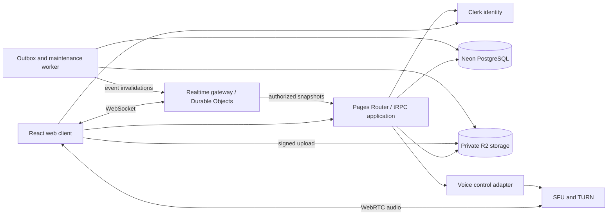

# High-Level Design

## 1. Architecture decision

Use a modular monolith for authenticated HTTP operations with a separate realtime gateway and background worker. PostgreSQL is the authoritative store. Keep Clerk for identity and R2 for private objects. The existing Cloudflare/vinext configuration makes Cloudflare the proposed initial host, subject to a compatibility spike. Do not migrate to App Router just for this feature set.

The diagram is proposed, not deployed topology. Cloudflare Durable Objects support WebSocket coordination and hibernation; gateway connection metadata must survive hibernation. [Cloudflare WebSocket documentation](https://developers.cloudflare.com/durable-objects/best-practices/websockets/)

## 2. Responsibilities and trust boundaries

| Component         | Responsibility                                                                 | Must not do                                    |
| ----------------- | ------------------------------------------------------------------------------ | ---------------------------------------------- |
| Web client        | Routes, UI state, optimistic cache, device audio                               | Decide membership/permissions authoritatively  |
| tRPC application  | Session verification, validation, authorization, transactional domain services | Trust client user IDs or object keys           |
| PostgreSQL        | Durable domain records, constraints, outbox and mutation deduplication         | Store transient typing heartbeats              |
| Realtime gateway  | Authenticated sockets, scoped invalidations, ephemeral typing/presence         | Become the source of truth for message content |
| Outbox worker     | Retry committed event publication, retention and attachment cleanup            | Publish uncommitted changes                    |
| R2                | Private binary storage                                                         | Grant read access solely from upload ownership |
| Voice adapter/SFU | Scoped room credentials, transport, participants, revocation                   | Infer access from room name alone              |

Public boundaries: application HTTPS, websocket upgrade, signed object endpoints and audio transport. Internal event publishing uses service authentication and replay protection. No database credentials or long-lived media service secrets reach clients.

## 3. Data and event flow

A message mutation checks access, creates a message and attachments linkage, allocates conversation sequence, and inserts an outbox event in one transaction. Only then return success. The worker publishes a lightweight invalidation; clients fetch authorized deltas. This deliberately avoids broadcasting message bodies from stale gateway authorization caches.

Each conversation owns monotonic message sequence numbers and a separate monotonic event sequence for edits/deletes/reactions. Updates bump entity versions. Unread compares message sequence to per-user read position. Reconnect uses event replay for mutations to old messages; message sequence alone cannot recover edits or deletes.

Gateway subscriptions comprise personal updates and currently visible conversation(s). Events for background conversations refresh unread summaries through personal invalidations. The worker computes eligible users in pages; pagination progress/retries are persisted. Ephemeral state expires and never needs historical replay.

## 4. Deployment and persistence

Web application: existing Pages Router using the selected validated build/runtime. Realtime: dedicated Cloudflare Worker plus Durable Objects, partitioned by user for connections and conversation for ephemeral fanout. Background execution: scheduled worker drains PostgreSQL outbox, bounded batches and retry backoff; publication is at least once. A fast post-commit dispatch attempt can reduce latency, but durable retries remain mandatory. Prove the 1-second fanout budget under the chosen scheduling model before release.

Current `drizzle-orm/neon-http` is adequate for existing simple queries. New read-modify-write domain transactions require a request-scoped transaction-capable connection (Neon WebSocket driver or validated PostgreSQL alternative). Do not emulate transactions with separate HTTP queries. Neon documents HTTP and WebSocket connection modes. [Neon serverless driver](https://neon.com/docs/serverless/serverless-driver)

Use pooled application connections and the existing direct database variable for reviewed Drizzle migrations. No application schema changes run during ordinary web builds. Separate development/preview data, Clerk instances, object prefixes and gateway/media namespaces from production.

## 5. Authorization and security

Verify Clerk session for every protected procedure. Local `app_users` projects identity and profile; passwords/session secrets remain with Clerk. `ensureUser` supports first-request creation so webhook timing cannot prevent onboarding. Verified identity webhooks are deduplicated and applied by provider event time; deleted users are disabled immediately.

Object access always derives from a visible message in an accessible conversation. Validate attachment size from stored metadata/object inspection, scan content, reject executable formats for v1, sanitize filenames and use short-lived signed downloads. Image previews are restricted to decoded/re-encoded raster formats; other files download as attachments. Pending uploads stay private.

Validate same-origin mutation requests and websocket Origin; authenticate socket tickets once and redact them from logs. Rate-limit per identity and IP; invite brute-force protections and user lookup quotas do not reveal membership or blocked state. Render sanitized text, constrain external link protocols and use a restrictive content security policy.

## 6. Scale and failure isolation

Start with one primary database region and bounded server sizes from SDD. Index conversation histories and user memberships; never fetch an entire server's message history. Virtualize long lists. Paginate member lists, friends, conversations, audit entries and search. Permission checks batch related role/overwrite reads; scope caches by authorization revision and invalidate on every access-affecting mutation.

Database unavailable: reject writes, keep local drafts, show reconnect/read-only state. Gateway unavailable: poll active conversation deltas and unread summary every 5 seconds while visible, with backoff; acknowledged writes remain durable. Worker unavailable: outbox accumulates with alerts, no content loss. R2 unavailable: text still works, attachment actions fail locally. Voice unavailable: text continues independently.

## 7. Operations and recovery

Structured telemetry: requestId, user pseudonymous ID, operation, conversation ID, latency, result code; exclude message bodies, invite tokens and signed URLs. Measure send acknowledgement, query latency, gateway connections, event lag, oldest undelivered outbox row, retry counts, permission-denial rates, media join failures and upload cleanup backlog.

Alert when outbox oldest pending age exceeds 30 seconds for 2 minutes, failed sends exceed 1% over 5 minutes, or database connection saturation exceeds validated limits. Dead-letter after 20 publication attempts, retain error and support manual replay; alert immediately on dead-letter.

Backup retention must cover the proposed RPO; perform quarterly restore drills on isolated infrastructure. Rebuild realtime state from connections and durable DB snapshots. After restore, invalidate cursors by changing a deployment/recovery epoch. Schema rollout is expand → compatible application → backfill → validate → remove obsolete fields. Retain rollback-compatible schema until old clients and workers are drained.

## 8. Tradeoffs and open decisions

| Decision                                   | Rationale / cost                                                                               |
| ------------------------------------------ | ---------------------------------------------------------------------------------------------- |
| tRPC instead of a second REST surface      | Fits current app; typed internal contracts; native clients would need a later public API       |
| Unified text conversations                 | Shared messages/read/search logic for server channels and DMs; channel metadata stays separate |
| Durable invalidations + authorized refetch | Simple permission boundary; extra reads versus pushing full message bodies                     |
| Outbox                                     | Correct commit/event coupling; requires worker monitoring and retention                        |
| Separate audio infrastructure              | Text hosting cannot substitute for media routing; provider, region and cost need validation    |

Voice provider choice is intentionally an implementation decision, with an adapter contract in API.md. No service was provisioned as part of documentation.
